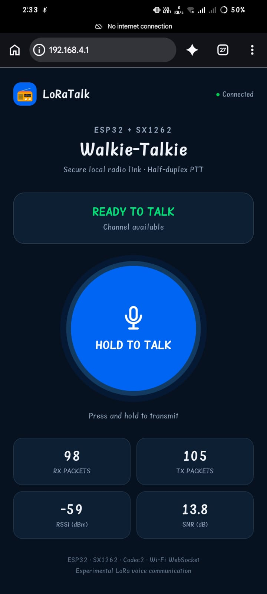
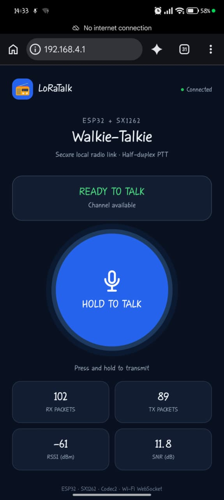
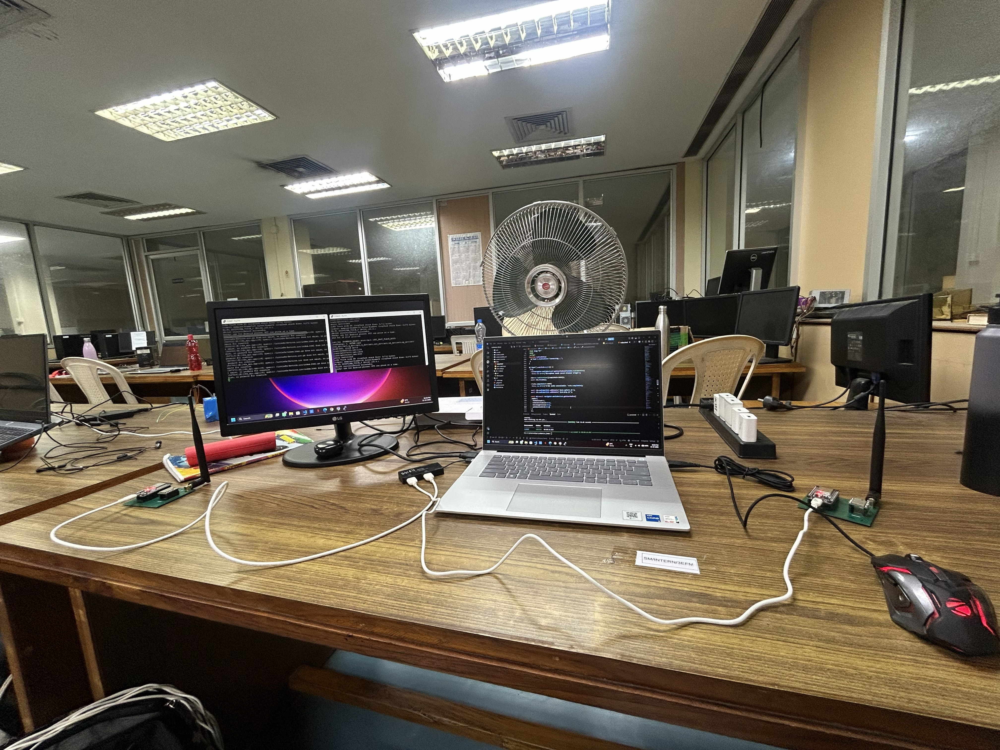
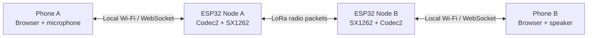

<div align="center">

# LoRaTalk
### ESP32 + SX1262 | Browser-Based LoRa Walkie-Talkie

**A two-node, half-duplex, push-to-talk voice communication prototype using LoRa radio, Codec2 speech compression, and a local Wi-Fi web interface.**

   

[Overview](#overview) · [Screenshots](#interface-screenshots) · [Hardware Demo](#hardware-demonstration-photo) · [How It Works](#how-it-works) · [Hardware](#hardware-and-wiring) · [Setup](#getting-started) · [Testing](#demonstration-and-observations)

</div>

---

## Overview

**LoRaTalk** is an experimental walkie-talkie system that connects a smartphone to an ESP32-based LoRa radio node over a **local Wi-Fi connection**. A browser-based push-to-talk (PTT) interface captures microphone audio, the system compresses speech using **Codec2**, and the ESP32 transmits voice data through an **SX1262 LoRa transceiver**. A second node receives the radio packets and makes decoded audio available for playback on its connected phone.

The prototype is intended to explore low-bitrate voice communication over a constrained radio link. **It does not require internet access for the local phone-to-node interface or the LoRa hop.** Each phone connects to its own ESP32 access point.

> [!IMPORTANT]
> This is a **research/demo prototype**, not a certified emergency communication product. The displayed “Connected” indicator refers to the local web interface; it is not proof that the remote radio node is currently reachable.

### Key capabilities

- **Push-to-talk:** press and hold the large microphone button to transmit.
- **Two-node radio communication:** ESP32/SX1262 nodes exchange voice packets over LoRa.
- **Local browser UI:** use a phone browser without installing a dedicated mobile application.
- **Speech compression:** Codec2-based low-bitrate voice processing.
- **Live telemetry:** display TX/RX packet counts, RSSI, and SNR.
- **Half-duplex operation:** one side transmits while the other receives.

## Interface Screenshots

Two screenshots captured during the prototype demonstration are shown below. Both show the LoRaTalk interface connected at `192.168.4.1`, with a ready-to-talk state and radio statistics.

<div align="center">
<table>
<tr>
<td align="center" width="50%"><strong>Phone / Node A</strong></td>
<td align="center" width="50%"><strong>Phone / Node B</strong></td>
</tr>
<tr>
<td align="center"></td>
<td align="center"></td>
</tr>
<tr>
<td align="center"><sub>RX 98 · TX 105 · RSSI −59 dBm · SNR 13.8 dB</sub></td>
<td align="center"><sub>RX 102 · TX 89 · RSSI −61 dBm · SNR 11.8 dB</sub></td>
</tr>
</table>
</div>

### Hardware Demonstration Photo

<div align="center">
  
  <p><em>Figure 3. Laboratory workbench setup used during LoRaTalk development and demonstration.</em></p>
</div>

The photograph documents the physical test environment, including computers, connected development hardware, and cabling. It complements the two phone-interface screenshots above. **It is not a measured range, latency, or reliability result.**

> **Photo file:** Place the original laboratory photograph at `docs/images/loratalk-node-c.jpg`. Use the original photo rather than a screenshot of the Windows photo viewer.

**Reading the indicators:** `RX PACKETS` and `TX PACKETS` are the counters displayed by each node. `RSSI` and `SNR` describe received radio signal conditions. These screenshots are **illustrative snapshots**, not a controlled packet-delivery or range measurement. The packet counters should not be divided to infer packet delivery ratio without synchronized test intervals and matching packet identifiers.

## System Architecture



**Two separate communication links are involved:**

1. **Phone ↔ ESP32:** the phone connects to the ESP32's Wi-Fi access point and opens the local browser interface.
2. **ESP32 ↔ ESP32:** compressed voice packets travel over the SX1262 LoRa radio link.

The browser interface is not an internet service, and the phones do not communicate directly with each other over Wi-Fi.

## How It Works

1. **Connect:** each phone joins its corresponding ESP32 Wi-Fi network and opens `http://192.168.4.1`.
2. **Start audio:** enable the browser's audio/microphone flow and grant permission when requested.
3. **Press PTT:** the transmitting phone captures speech while the user holds the button.
4. **Encode and send:** the speech is converted to low-bitrate Codec2 data, packaged, and sent through the ESP32/SX1262 radio.
5. **Receive and play:** the other ESP32 receives packets; the receiving phone plays the decoded speech through the browser audio pipeline.
6. **Release PTT:** the transmitter stops sending and returns to the ready state.

```text
VOICE TRANSMIT PATH
Microphone → Browser audio capture → Codec2 voice frames
           → ESP32 → SX1262 → LoRa radio channel

VOICE RECEIVE PATH
LoRa radio channel → SX1262 → ESP32 → Codec2 decode
                   → Browser audio playback → Phone speaker
```

> [!NOTE]
> The implementation is **half-duplex**. Simultaneous speaking is not supported as full-duplex audio. Channel-busy handling and collision avoidance should be verified separately rather than assumed from the visual READY state.

## Hardware and Wiring

### Hardware used

| Component | Role |
|---|---|
| 2 × ESP32 development boards | Wi-Fi access points, application logic, and radio control |
| 2 × SX1262 LoRa transceiver modules | Long-range, low-data-rate radio link |
| 2 × compatible antennas | Radio transmission/reception |
| 2 × smartphones | Browser microphone, PTT controls, and audio playback |
| USB cables and suitable power supplies | Programming and powering each node |

### ESP32 ↔ SX1262 pin connections

| SX1262 signal | ESP32 GPIO |
|---|---:|
| MOSI | 23 |
| MISO | 19 |
| SCK | 18 |
| NSS / CS | 5 |
| BUSY | 27 |
| RESET | 14 |
| DIO1 | 26 |
| VCC | 3.3 V |
| GND | GND |

**Important:** use a compatible **3.3 V** radio module, a common ground, and an antenna matched to the configured frequency. Confirm the particular module's power requirements and pinout before wiring. Do not transmit without a suitable antenna.

## Software Stack

| Layer | Technology | Purpose |
|---|---|---|
| Application interface | HTML / JavaScript | Mobile-friendly PTT UI and telemetry |
| Audio pipeline | Browser audio scripts + Codec2 | Speech capture, low-bitrate encoding/decoding, playback |
| Local transport | ESP32 Wi-Fi AP + WebSocket | Browser-to-node communication |
| Radio driver | RadioLib | SX1262 radio control |
| Firmware | ESP32 / Arduino framework | Packet handling and device coordination |
| Build and upload | PlatformIO | Separate node firmware environments |

### Repository layout

```text
LoRaVoice_Demo/
├── README.md                 # This documentation
├── README.txt                # Earlier project notes
├── platformio.ini            # PlatformIO environments and dependencies
├── src/
│   └── main.cpp              # ESP32 application firmware
├── data/
│   ├── index.html            # Browser UI
│   ├── pcm-capture.js        # Microphone capture script
│   └── pcm-play.js           # Audio playback script
├── lib/
│   └── Codec2/               # Project-local Codec2 source/library
└── docs/
    └── images/              # Two phone screenshots + lab demonstration photo
```

Generated build folders such as `.pio/`, `codec2_build/`, and `codec2_build_ucrt/` are not needed in version control.

## Getting Started

### Prerequisites

- VS Code with the **PlatformIO IDE** extension (or PlatformIO Core).
- Two correctly wired ESP32 + SX1262 nodes.
- Two phones with modern browsers and microphone access.
- A USB connection for each ESP32 when flashing firmware.

### 1. Open the project

Clone the existing organization repository, then open the `LoRaVoice_Demo` subfolder as the **PlatformIO project**:

```bash
git clone https://github.com/SWAN-Interns-2026/Underground_Communication.git
cd Underground_Communication/LoRaVoice_Demo
```

> Repository access is required because the organization repository may be private.

### 2. Build and upload the firmware

The project uses two PlatformIO environments: `node08` and `node09`. Connect one ESP32 at a time or specify its upload port explicitly.

```bash
# Build each node
pio run -e node08
pio run -e node09

# Flash the corresponding device
pio run -e node08 -t upload
pio run -e node09 -t upload
```

If automatic serial-port detection fails, add `--upload-port COMx` with the correct port for that board (Windows example).

### 3. Upload the web interface

The browser UI is stored in `data/`. After flashing the firmware, upload the filesystem image for **each node**:

```bash
pio run -e node08 -t uploadfs
pio run -e node09 -t uploadfs
```

If needed, specify `--upload-port COMx`. Uploading firmware alone may not update the HTML/JavaScript files served by the ESP32.

### 4. Connect the phones

| Device | Wi-Fi access point | Local page |
|---|---|---|
| Node 08 | `LORA_VOICE_8` | `http://192.168.4.1` |
| Node 09 | `LORA_VOICE_9` | `http://192.168.4.1` |

Connect each phone to the matching ESP32 network. If the phone warns **“No internet connection,”** keep using that Wi-Fi network: this is expected for a local access point without internet connectivity. Use the AP credentials configured in your firmware; change any default password before a wider demonstration.

### 5. Make a voice call

Open the local page on both phones, start/enable audio as required by the browser, allow microphone access, then **press and hold HOLD TO TALK** on one phone. Release it before speaking from the other side. Watch the packet counters and audio playback during the test.

> [!TIP]
> If the page opens but audio does not work, check microphone permissions, browser audio activation, filesystem upload, and the ESP32 serial logs. Browser permission behavior may vary by device and browser.

## Demonstration and Observations

The two phone screenshots show the following interface readings. The additional laboratory photo documents the physical demonstration setup:

| Metric | Phone / Node A | Phone / Node B |
|---|---:|---:|
| Interface state | Connected; READY TO TALK | Connected; READY TO TALK |
| Received packets | 98 | 102 |
| Transmitted packets | 105 | 89 |
| Displayed RSSI | −59 dBm | −61 dBm |
| Displayed SNR | 13.8 dB | 11.8 dB |

These observations demonstrate that the interfaces were running and reporting radio statistics. During development, a two-node Codec2/LoRa voice exchange was tested, but **controlled quantitative results** for intelligibility, packet delivery ratio, end-to-end voice latency, range, and operation under interference have not been documented here.

## Current Limitations

- **Half-duplex only:** no simultaneous two-way speech.
- **Constrained throughput:** LoRa has limited airtime capacity, so audio framing and radio settings affect responsiveness.
- **Loss and delay:** radio interference, dropped packets, or browser buffering may interrupt audio.
- **Browser dependency:** microphone permissions and autoplay restrictions can vary across devices.
- **Not an end-to-end security claim:** a local Wi-Fi link does not by itself guarantee encrypted LoRa voice. Cryptographic protection has not been verified for this README.
- **No certified reliability or coverage:** field range, emergency suitability, and multi-user scalability require dedicated testing.

## Next Steps

Potential improvements include repeatable voice-latency and packet-loss measurements, speech intelligibility evaluation, better channel-busy/PTT arbitration, radio-range testing in realistic environments, and documented comparisons across LoRa spreading factors and bandwidths.

## References

- [GitHub documentation — README files and relative images](https://docs.github.com/en/repositories/managing-your-repositorys-settings-and-features/customizing-your-repository/about-readmes)
- [PlatformIO documentation — project structure and build workflow](https://docs.platformio.org/en/latest/core/quickstart.html)
- [RadioLib project](https://github.com/jgromes/RadioLib)
- [Codec2 project](https://github.com/drowe67/codec2)

---

<div align="center">

**LoRaTalk — Experimental LoRa voice communication using ESP32, SX1262, and Codec2.**

*Project demonstration documentation · October 2026*

</div>
